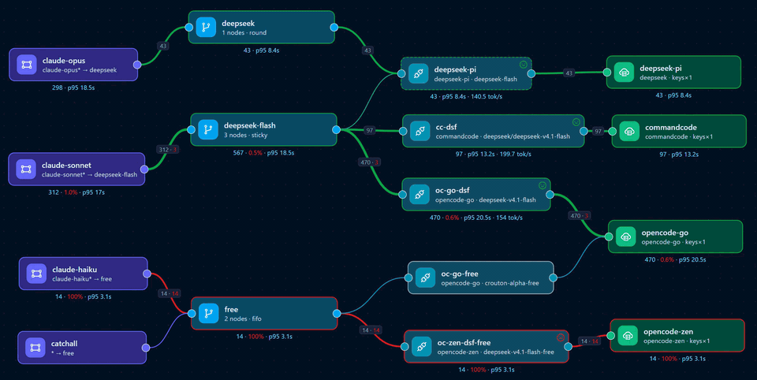

# Cuttle

**The cuttlefish of LLM gateways.** / **一个入口，所有方言。**

`Cuttle` is a self-hosted LLM gateway with an embedded admin console. It gives
clients one stable endpoint for several providers, routes each client model to a
provider model, converts between wire APIs, and records per-request statistics.

The name is short for **cuttlefish**: many arms, rapid mimicry, and near-invisible
camouflage — the same properties a gateway needs to reach many providers, speak
each API dialect, and stay out of the client's way.



*The overview topology: entrypoints, routes, nodes and providers with live
metrics.*

## What it does

- Accepts OpenAI Chat Completions, OpenAI Responses, Anthropic Messages and
  Gemini `generateContent` requests.
- Converts requests and responses between the inbound API and the provider's
  native API.
- Matches client model names with case-insensitive globs and an explicit
  precedence order.
- Balances or fails over across provider keys, nodes and backup nodes.
- Locks provider keys to a write-only admin flow and masks previews in the API.
- Authenticates data-plane clients with named gateway keys and reports per-key
  usage, or stays open when no keys are configured.
- Serves an admin console for providers, nodes, routes, entrypoints, gateway
  keys, requests, a provider usage/balance view and a live topology view.
- Stores request history and rollups in SQLite; the topology can be filtered by
  time range down to one minute.
- Reloads configuration on `SIGHUP` or immediately after an admin edit.
- Starts without a config file: a zero-config first run creates the config and
  a one-time admin password under `$CUTTLE_DATA`, then the console creates the
  upstream topology.

## Routing model

Every request follows one chain:

```text
client model
    │  glob match, entrypoint order
    ▼
Entrypoint ──► Route ──► Node ──► Provider model
                 │          │
                 │          └─ one provider + one model
                 └─ ordered nodes + strategy (fifo / round / random / sticky)
```

- An **entrypoint** is the client-facing ingress. It has a name, a non-empty
  list of model globs, and exactly one route.
- Entrypoints are evaluated in declaration order. The first entrypoint with a
  matching glob wins; `*` is the explicit catch-all.
- Globs are case-insensitive. `*` is the only wildcard.
- A **route** contains only nodes and a selection strategy. It does not match
  anything by itself.
- A **node** binds one provider and one provider model. `backup` marks fallback
  nodes; `weight` controls the round-robin share.
- A node's target API is `auto` by default. The gateway matches the inbound wire
  API (`/v1/chat/completions`, `/v1/responses`, `/v1/messages`, or
  `/v1beta/models/...`) to a configured provider API and converts only when the
  provider has no matching base URL. Set `api` on the node to pin one API.
- Disabling a provider, a node, or a provider model removes that node from the
  compiled route. A route with no usable nodes fails the request instead of
  passing the client model through.
- If no entrypoint matches, the request is unrouted and returns an error.

> The routing model is intentionally strict. Old configurations using
> `aliases`, route `match`, or node `models` maps are rejected at load time.
> There is no automatic migration.

## Quick start

### Requirements

- Go 1.26.4 or newer (`go.mod`) to build from source.
- Node.js 22 and npm to rebuild the admin console.
- SQLite is embedded; no external database is required.

The module depends on the published versions of `core`, `x` and
`llm-api-converter`; no sibling checkouts are required. If a parent `go.work`
exists, `GOWORK=off` keeps the build on the tagged module versions instead of
the local workspace directories.

### Download

Prebuilt binaries for Linux, macOS and Windows are attached to every
[GitHub release](https://github.com/ginuerzh/cuttle/releases). Archives are
listed in `checksums.txt`; verify before running a downloaded binary:

```bash
sha256sum -c checksums.txt --ignore-missing
```

### Build

```bash
# from the cuttle directory
(cd web && npm ci && npm run build)
GOWORK=off go build -o cuttle .
```

The web build writes to `internal/admin/dist`, which is embedded into the Go
binary. The `GOWORK=off` flag keeps the build scoped to this module when a
parent `go.work` exists.

### Versioning

`cuttle version` (also `--version` and `-v`) prints the build identity. Release
tags report `vX.Y.Z`, builds from `main` report `main-<short-sha>`, and a plain
local build reports `dev`. The same value appears at the bottom of the admin
navigation panel and in `GET /api/health` as `version`, `commit` and `builtAt`.

CI passes the tag or branch identity to the Docker build. A local build can set
it explicitly:

```bash
GOWORK=off go build \
  -ldflags "-X github.com/ginuerzh/cuttle/internal/version.Version=dev \
    -X github.com/ginuerzh/cuttle/internal/version.Commit=$(git rev-parse HEAD) \
    -X github.com/ginuerzh/cuttle/internal/version.BuildDate=$(date -u +%Y-%m-%dT%H:%M:%SZ)" \
  -o cuttle .
```

Releases are created by pushing an annotated `vX.Y.Z` tag. The release workflow
builds the console and publishes GoReleaser archives plus checksums to GitHub,
while the Docker workflow publishes the semver image tags alongside `latest`.

### Zero-config first run

No config file is required. Start the binary (or the Docker image) and it
creates `$CUTTLE_DATA/cuttle.yaml` and `$CUTTLE_DATA/stats.sqlite`:

```bash
CUTTLE_DATA=./data ./cuttle serve
```

If `CUTTLE_ADMIN_PASSWORD` is not set, Cuttle generates a 32-character admin
password, prints it once to stderr, and stores only its bcrypt hash. Open the
admin console, log in, and create a provider, node, route and entrypoint. No
provider, key or model environment variables exist.

| Variable | Default | Meaning |
| --- | --- | --- |
| `CUTTLE_DATA` | `/data` | Directory for the generated config and stats database |
| `CUTTLE_LISTEN` | `:8787` | First-run `gateway.listen` |
| `CUTTLE_ADMIN_LISTEN` | `127.0.0.1:8788` (binary); `:8788` (Docker image) | First-run `admin.listen` |
| `CUTTLE_ADMIN_PASSWORD` | unset | First-run admin password; hashed into the config |

All four are optional. The three config-value variables are **first-run
defaults**: once a config exists, the file and the console are authoritative and
the variables are ignored (a differing value logs a warning). `CUTTLE_DATA` is
also used to locate an existing config.

`-c` is optional. Without it, Cuttle uses the first existing path from:

1. `$CUTTLE_DATA/cuttle.yaml`
2. `/etc/cuttle/cuttle.yaml` (Docker mount)
3. `./cuttle.yaml` (working-directory config)

If none exists, it generates a new config in `$CUTTLE_DATA`. An explicitly
supplied `-c` path must exist.

To choose the password before the first run, set `CUTTLE_ADMIN_PASSWORD` (8–72
bytes; a trailing newline is trimmed, matching `cuttle hash-password`). If the
generated password is lost, replace `admin.passwordHash` with the output of
`cuttle hash-password`, or delete the config (destructive: it also deletes the
topology; persisted sessions are cleared on regeneration).

The rest of this section describes the full manual YAML configuration, which is
still supported and is the right choice for multi-provider topologies.

### Minimal configuration

Create `cuttle.yaml`:

```yaml
gateway:
  listen: ":8787"

admin:
  listen: "127.0.0.1:8788"
  passwordHash: "<bcrypt hash>"   # empty disables the admin server

stats:
  path: "stats.sqlite"

entrypoints:
  - name: default
    match: ["*"]
    route: default

providers:
  - name: deepseek
    type: deepseek
    chat: https://api.deepseek.com/v1
    responses: https://api.deepseek.com/v1
    anthropic: https://api.deepseek.com/anthropic
    keys:
      - ${DEEPSEEK_API_KEY}

nodes:
  - name: deepseek-fast
    provider: deepseek
    model: deepseek-v4-flash
    # api: auto

routes:
  - name: default
    nodes: [deepseek-fast]
    strategy: round
```

Generate the admin password hash:

```bash
read -rsp "Admin password: " PASSWORD; echo
printf '%s' "$PASSWORD" | ./cuttle hash-password
```

Paste the output into `admin.passwordHash`.

### Run

Zero-config first run (no YAML file):

```bash
CUTTLE_DATA=./data ./cuttle serve
```

The log prints a one-time admin password. Open the admin console, log in, and
create the provider, node, route and entrypoint there. This is the same path the
Docker image uses.

Manual configuration:

```bash
DEEPSEEK_API_KEY=sk-... ./cuttle serve -c cuttle.yaml
```

- Gateway: `http://127.0.0.1:8787`
- Admin console: `http://127.0.0.1:8788/`

Send a request (after the manual DeepSeek topology or an equivalent zero-config
topology exists in the console):

```bash
curl http://127.0.0.1:8787/v1/chat/completions \
  -H 'Content-Type: application/json' \
  -d '{
    "model": "claude-sonnet-4-5",
    "messages": [{"role": "user", "content": "Say OK"}]
  }'
```

Because the entrypoint matches `*`, any client model is accepted. The response
`model` field is the provider model that actually served the request
(`deepseek-v4-flash` in this example).

Reload after editing the file:

```bash
pkill -HUP -f 'cuttle serve'
```

## Admin console

The console is a React application embedded in the binary. It is served only
when `admin.passwordHash` is set.

| Page | What it manages |
| --- | --- |
| Providers | Provider type, API base URLs, keys, model catalog, disabled models, health probes |
| Nodes | Provider, one model, backup flag, weight, enabled switch |
| Routes | Ordered node list and strategy |
| Entrypoints | Ordered model globs and the route they select |
| Gateway keys | Named data-plane credentials, per-key 24h/7d/30d usage, enable switches, rotation |
| Sessions | Session history, timing, tokens, status and errors |
| Usage | Per-provider local usage and upstream balance or quota windows |
| Overview | Entrypoint → route → node → provider graph with live metrics, per-node output token speed, one-shot traffic-flow dots and a notification bell for recent gateway-key auth failures |
| Settings | Listen addresses, retention and admin password |

Admin edits validate the new configuration, apply it to the data plane, and
then atomically rewrite the config file with `0600` permissions.

Provider keys are write-only through the admin API: `GET` returns only
`keysSet` and masked `keyPreviews`. New keys can be appended and existing keys
can be deleted; an existing key cannot be replaced in place.

A provider's `type` and its non-`generic` API base URLs are immutable after
creation. Delete and recreate the provider to change them, or edit the config
file and reload.

The topology view has monitor and edit modes. In monitor mode nodes are fixed;
in edit mode you can drag an entrypoint onto a route or a route onto a node to
change the configuration. Node positions are stored in the stats SQLite
database and shared by every admin; `localStorage` keeps a local backup and is
used if the server cannot be reached.

The monitor streams live data over the `GET /api/events` WebSocket. New traffic
flashes the node icon once and sends light dots along the connection. The
toolbar `动画` (Animation) switch stops both effects without pausing metrics and
is remembered per browser. The time selector picks the initial lookback; the end
is always the current time, so request, error and token totals only increase
until you start a new session.
Rejected gateway-key requests are tracked in memory (the last 50 since process
start; credentials are never kept). The bell next to the edit toggle shows a
red dot while any are retained; click it for the newest first list with the
reason, client IP, method, path and time, and use `清除` to empty the record.
The bell stays live in edit mode, and these failures are not written to SQLite.
The selector keeps its labels but now means "look back this far when the
session starts". **Reset stats** clears the display and reconnects with
`reset=1`, starting at zero without querying history. A session older than
seven days is closed and restarted from the selected lookback. P50/P95 are
percentiles over the accumulated window, not cumulative sums. See
[Admin API](#admin-api) for the reverse-proxy requirements.

## Configuration reference

`config.Load` uses strict YAML decoding. Unknown fields fail the load, which is
why old routing keys are rejected instead of silently ignored. Names, URLs,
keys, models and match globs support `${VAR}` and `$VAR` environment expansion.
See [example.yaml](example.yaml) for a complete configuration.

A config file is optional; see [Zero-config first run](#zero-config-first-run)
for the generated path and the four first-run environment variables. Once a
config exists, it is the source of truth and those variables are not reapplied.

### Top level

```yaml
gateway: { ... }
admin: { ... }
stats: { ... }
log: { ... }
entrypoints: [ ... ]
providers: [ ... ]
nodes: [ ... ]
routes: [ ... ]
```

### `gateway`

| Field | Default | Description |
| --- | --- | --- |
| `listen` | `:8787` | Data-plane listen address |
| `readTimeout` | `60s` | Deadline for reading upstream HTTP response headers; 1s–300s |
| `userAgent` | `cuttle/<version>` | Upstream User-Agent; provider-level `userAgent` or `headers` can override it |
| `keys` | empty (data plane open) | Named data-plane access keys; see [Gateway keys](#gateway-keys) |

### Gateway keys

Named gateway keys authenticate clients on the data-plane port. They are
separate from the admin password and are never forwarded to a provider.

```yaml
gateway:
  listen: ":8787"
  keys:
    - name: claude-code
      key: ${CLAUDE_GATEWAY_KEY}
      enabled: true
    - name: laptop-sdk
      key: sk-gw-...
      enabled: false
```

| Field | Required | Description |
| --- | --- | --- |
| `name` | yes | Unique name, at most 64 characters, no `/`, `$` or control characters |
| `key` | yes | Unique value, 8–512 characters, no `$` or control characters; `${VAR}`/`$VAR` are expanded |
| `enabled` | no | Default `true`; a disabled entry stays configured but never authenticates |

Names and values must not contain a literal `$` after environment expansion.
`config.Load` expands `${VAR}` and `$VAR` on every reload, so a value stored
verbatim through the admin API would be reinterpreted or fail startup the next
time the config is loaded. Put the secret in the environment and reference it,
or paste a value that contains no `$`. Control characters are rejected in
values as well because they can never authenticate.

An absent or empty `keys` list keeps the data plane open. Any entry turns
authentication on. If every entry is disabled, every data-plane request is
rejected with 401 and the gateway logs a warning when the configuration is
applied.

Accepted credential headers:

- `Authorization: Bearer <value>` (the scheme is case-insensitive)
- `x-api-key: <value>`
- `x-goog-api-key: <value>`
- `api-key: <value>`

**Any candidate may authenticate.** A junk value in one header does not veto a
valid value in another, which is the normal Claude Code and SDK case. When
several candidates match, the request is attributed to the first enabled key in
configuration order. Query-string credentials (for example Gemini's `?key=`) are
not supported and do not authenticate.

`GET` and `HEAD /api/hello` remain public for Claude Code's connection probe.
Every other path, including `POST /v1/messages/count_tokens`, requires a valid
key when any key is configured. In authenticated mode the gateway serves exactly
one request per connection; keep-alive reuse requires a new connection and
re-authentication.

A rejected request gets:

```http
HTTP/1.1 401 Unauthorized
Content-Type: application/json
WWW-Authenticate: Bearer realm="cuttle"
Connection: close

{"error":{"message":"invalid gateway key","type":"authentication_error"}}
```

The gateway does not call the upstream. It logs a warning with the client IP,
method, path and reason (`missing`, `disabled` or `invalid`); the credential is
never logged. The same failures are kept in a bounded in-memory record and shown
in the Overview notification bell; `清除` empties that record and they reset
when the gateway restarts. A malformed request head returns 400. The 401 body
and headers are
the same for every inbound protocol.

Manage keys on the Gateway keys page or through the [Admin API](#admin-api).
`POST /api/gateway-keys` and `POST /api/gateway-keys/{name}/rotate` return the
new secret once; copy it then, because later reads only return a masked preview.
`PUT` changes only the enabled flag. Rotation and deletion take effect on the
next request without a restart: the data plane reloads before the config file is
written.

Per-key requests, errors and input/output/cached tokens come from hourly
`key_rollups`, so they remain accurate for the 7-day and 30-day views even
though raw request rows are retained for 168 hours by default. Usage recorded
before this feature has no key attribution, and deleted keys keep their history
as unconfigured rows until normal rollup retention removes it.

### `admin`

| Field | Default | Description |
| --- | --- | --- |
| `listen` | `127.0.0.1:8788` | Admin listen address |
| `passwordHash` | empty | bcrypt hash; empty disables the admin server |
| `sessionTTL` | `12h` | Normal session lifetime |
| `rememberTTL` | `720h` | Lifetime of a remembered session |

### `stats`

| Field | Default | Description |
| --- | --- | --- |
| `path` | `stats.sqlite` | SQLite database path |
| `retainRequests` | `168h` | Raw request retention |
| `retainRollups` | `2160h` | Aggregated rollup retention |
| `capture.mode` | `off` | `off`, `errors` or `sample` |
| `capture.sampleRate` | `0.01` | Sample rate when mode is `sample` |
| `capture.maxBytes` | `32768` | Maximum bytes per preview field |
| `capture.retain` | `24h` | Capture row retention |

`errors` buffers every request but persists only failures (`status >= 400` or a
non-empty error). `sample` persists a random subset. On-demand capture rules can
be created from the Sessions page or `POST /api/captures`; they are
time/limit-bounded, in-memory, and lost on restart. `stats.storeBody` is removed.

Captured failures also include an allowlisted header subset: `content-type`,
`user-agent`, `retry-after`, `x-request-id`, `x-cuttle-request-id`,
`x-opencode-session`, `cf-ray`, `anthropic-version`, and
`anthropic-ratelimit-*` / `x-ratelimit-*`. Authorization, cookie, set-cookie
and API-key headers are never stored.

Captured bodies may contain prompts and tool arguments; keep capture off outside
an investigation, use a short retention, and protect the admin session and
database. Capture stores the bodies visible to the rewriter, not necessarily
byte-identical wire bytes: x skips compressed SSE and chunked non-streaming
bodies over its `MaxChunkSize` (1 MiB default), and adds SSE framing after the
rewriter.

### `log`

| Field | Default | Description |
| --- | --- | --- |
| `level` | `info` | `trace`, `debug`, `info`, `warn`, `error` or `fatal`; can change at runtime |
| `format` | `json` | `json` or `text`; fixed at startup |

`SIGHUP` and an admin config save apply a new `level` immediately, including the
`llm-api-converter` debug output routed through the same handler. A changed
`format` takes effect after a restart and logs a warning when changed at runtime.
`trace` also enables the underlying x request/response header dumps, which can
contain client credentials such as `Authorization` or `x-api-key`; use it only
for short debugging sessions and protect the log stream.

### `entrypoints[]`

```yaml
- name: fast
  match:
    - "claude-sonnet*"
    - "gpt-4.5*"
  route: fast
```

| Field | Required | Description |
| --- | --- | --- |
| `name` | yes | Unique entrypoint name; no `/` |
| `match` | yes | Non-empty list of client model globs |
| `route` | yes | Existing route name |

Declaration order is the matching precedence. Globs inside one entrypoint are a
union.

### `providers[]`

```yaml
- name: deepseek
  type: deepseek
  chat: https://api.deepseek.com/v1
  responses: https://api.deepseek.com/v1
  anthropic: https://api.deepseek.com/anthropic
  keys: ["${DEEPSEEK_API_KEY}"]
  models:
    deepseek-v4-pro:
      disabled: true
```

| Field | Required | Description |
| --- | --- | --- |
| `name` | yes | Unique provider name |
| `type` | yes | `deepseek`, `opencode-go`, `opencode-zen`, `commandcode`, `openrouter`, `generic` |
| `chat` | no | OpenAI Chat Completions base URL |
| `responses` | no | OpenAI Responses base URL |
| `anthropic` | no | Anthropic Messages base URL |
| `gemini` | no | Gemini API base URL |
| `keys` | no | API keys; expanded from the environment |
| `models` | no | Local overrides, currently `disabled: true` |
| `auth` | no | Header/prefix/key-header overrides |
| `userAgent` | no | Overrides `gateway.userAgent` for this provider |
| `headers` | no | Extra upstream request headers; applied after auth and before `auth.extra` |
| `health` | no | Probe API, path, interval (default `30s`), timeout (default `5s`) |
| `tls` | no | `serverName`, `secure` (default `true`) |
| `enabled` | no | Set `false` to remove the provider from routing |

An empty API base URL means the provider does not serve that API. A node's
target API is chosen as follows:

- `auto` (the default) matches the inbound wire API to a configured provider
  API: `/v1/messages` uses `anthropic`, `/v1/responses` uses `responses`,
  `/v1/chat/completions` uses `chat`, and Gemini paths use `gemini`.
- When the matching base URL is missing, or the model's static classification
  excludes it, the gateway keeps the model's default API and converts the body.
- A pinned `node.api` bypasses default resolution and always uses that API.
  Generic providers have no static model classification, so auto matching is
  how their configured base URLs are selected.

The gateway authenticates every upstream request with the provider's configured
key and never forwards inbound client credentials. `Authorization`, `x-api-key`,
`x-goog-api-key` and `api-key` are removed before the provider headers are
applied; `auth.extra` is applied last and still wins. This matters when a client
such as Claude Code sends its own `Authorization` header, because upstreams may
prefer it over the injected `x-api-key` and reject the provider key.

The gateway also owns the upstream `User-Agent`: it sends
`gateway.userAgent` (default `cuttle/<version>`) instead of the client's UA.
`provider.userAgent` overrides it, and `provider.headers` can add or replace
any header except `Host`, `Content-Length`, `Transfer-Encoding`, `Connection`,
`Proxy-Connection`, `Upgrade`, `Accept-Encoding` and `Proxy-Authorization`.
This prevents clients such as `Python-urllib` from being rejected by
Cloudflare bot rules (CommandCode `error code: 1010`). The client's own UA is
still recorded in `stats.requests.user_agent` for attribution.

For `opencode-go` providers the gateway injects `x-opencode-session` from the
request ID when the client sent no session-like header at all. If the client
already sends a session header, including Claude Code's native session header,
it is preserved. Without a recognized session header, OpenCode returns 400
`MissingSessionID`.

With the quick-start example above, Claude Code talking Anthropic Messages to
`/v1/messages` is forwarded to DeepSeek's native
`https://api.deepseek.com/anthropic` endpoint instead of being converted to the
chat API.

`openrouter` is a built-in provider type with native Chat, Responses and
Anthropic Messages endpoints. All three use `Authorization: Bearer`:

```yaml
- name: openrouter
  type: openrouter
  chat: https://openrouter.ai/api/v1
  responses: https://openrouter.ai/api/v1
  anthropic: https://openrouter.ai/api
  keys: ["${OPENROUTER_API_KEY}"]
```

OpenRouter does not implement `/v1/messages/count_tokens`, so its routes answer
those requests with the gateway's local token estimate while still forwarding
Messages to the native endpoint.

### `nodes[]`

```yaml
- name: deepseek-fast
  provider: deepseek
  model: deepseek-v4-flash
  api: auto
  backup: false
  weight: 1
  enabled: true
```

| Field | Required | Description |
| --- | --- | --- |
| `name` | yes | Unique node name; no `/` |
| `provider` | yes | Existing provider name |
| `model` | yes | Exactly one provider model ID |
| `api` | no | `auto` (default), `chat`, `responses`, `anthropic` or `gemini`; a pinned API requires the matching base URL |
| `backup` | no | Mark as a fallback node |
| `weight` | no | Selection weight; default `1`, must be `>= 0` |
| `enabled` | no | Set `false` to remove the node from routing |

### `routes[]`

```yaml
- name: fast
  nodes: [deepseek-fast, deepseek-backup]
  strategy: round
  maxFails: 2
  failTimeout: 30s
```

| Field | Required | Description |
| --- | --- | --- |
| `name` | yes | Unique route name; no `/` |
| `nodes` | yes | Ordered list of existing node names; duplicates rejected. Order is the selection priority. |
| `strategy` | no | `fifo`, `round` (default), `random` or `sticky` |
| `maxFails` | no | Consecutive failures before a node is marked dead; default `1` |
| `failTimeout` | no | How long a dead node is skipped; default `10s` |

`sticky` keeps one conversation on one node: it reads the client's session
header (`x-claude-code-session-id`, `x-opencode-session`, `x-session-id` and the
other known session headers) and uses weighted rendezvous hashing, so new
conversations split by node weight while a conversation keeps its upstream
prompt cache. A request without a session header falls back to weighted random.

## Stats and topology

Requests are recorded with route, node, provider, client model, target model,
gateway key, status, duration and token counts. The `gateway_key` column holds
the name of the key that authenticated the request and is empty in open mode.
Raw rows are retained for `stats.retainRequests`; rollups are retained for
`stats.retainRollups`. Rollups also store `cached_tokens`; rows written before
that column existed read as 0 cached tokens.

Hourly `key_rollups` store requests, errors and input/output/cached tokens per
gateway key for the per-key usage view. They use the same
`stats.retainRollups` cutoff as provider rollups, so deleting a key keeps its
history only until normal cleanup removes it. Rows and rollups written before
gateway keys existed have no key attribution and are not backfilled. Rejected
401 requests and locally answered `count_tokens` requests are not recorded in
SQLite, so they produce no key usage; rejected 401s are still surfaced in the
Overview notification bell.

`GET /api/routes/health` returns each route's node markers: `failCount`,
`lastFailure`, `dead` and `deadUntil`. The state is x's in-memory marker,
resets when the hop is rebuilt, and only reflects the failures x marks (TCP
dial failures and configured HTTP `failCodes`, currently 429 and 5xx). A
streaming HTTP 200 truncation is not a marker failure.

The graph API attributes each row to an entrypoint at query time by resolving
the row's `client_model` through the current entrypoint list:

```text
entrypoint:<name> -> route:<recorded route>
```

The edge uses the route recorded on the request, not the entrypoint's current
route. Renaming or reordering entrypoints therefore changes the historical
attribution, while old rows keep the route that actually served them. Rows with
no recorded route are shown as `unrouted`.

The topology only counts rows that still belong to the current topology: the
route must exist, the node must be referenced by that route, and the node's
provider must match. Stale historical nodes do not show old traffic.

## Admin API

All `/api/*` routes except `/api/health`, `/api/login` and `/api/logout`
require a session cookie.

```text
GET  /api/health
POST /api/login
POST /api/logout

GET  /api/config
PUT  /api/config
GET  /api/presets

GET|POST      /api/providers
GET|PUT|DELETE /api/providers/{name}
POST          /api/providers/{name}/test
GET           /api/providers/{name}/models

GET|POST      /api/nodes
GET|PUT|DELETE /api/nodes/{name}
GET|POST      /api/routes
GET           /api/routes/health
PUT|DELETE    /api/routes/{name}
GET|PUT       /api/entrypoints

GET|POST      /api/gateway-keys
PUT|DELETE    /api/gateway-keys/{name}
POST          /api/gateway-keys/{name}/rotate
GET           /api/gateway-key-usage

GET  /api/stats/summary
GET  /api/stats/errors
GET  /api/stats/graph
GET  /api/events                      (WebSocket)
GET  /api/alerts
GET|PUT /api/topology/positions
GET  /api/requests
GET  /api/requests/{id}
GET  /api/provider-usage
GET|POST      /api/captures
DELETE        /api/captures/{id}
PUT  /api/admin/password
```

`GET /api/requests` accepts `errors=1`, `captured=1`, `errorClass=<class>` and
`key=<name>` (exact gateway key name). Request rows carry an optional
`gatewayKey` field with the authenticated key name; the Sessions list and detail
show it. Request detail includes an optional `capture` object; the list only
reports a cheap `hasCapture` flag. `GET /api/stats/errors` aggregates the window
by `error_class`, provider, route and client model, and returns top message
fingerprints plus hourly buckets. `GET /api/alerts` evaluates the last 15
minutes for auth failures, an error-rate spike, gateway timeouts and excessive
stream truncation; alerts are UI-only in P1.

`GET /api/gateway-keys` lists `{name,keyPreview,enabled}` in configuration
order and returns `[]` when none are configured. `POST /api/gateway-keys` takes
`{name,enabled}`, generates a 256-bit `sk-gw-...` secret and returns `201` with
`{name,key}`. `PUT /api/gateway-keys/{name}` changes only `enabled` and returns
`204`; `DELETE` returns `204` and keeps historical usage.
`POST /api/gateway-keys/{name}/rotate` returns `200` with a new `{name,key}`,
and the old value stops working on the next request. Create and rotate are the
only responses that contain a raw key; create is the deliberate exception to the
empty `201` body. `GET /api/gateway-key-usage` accepts `from`/`to` and returns
range totals plus per-key requests, errors and tokens. Configured keys appear in
order including zero usage, deleted keys are appended alphabetically with
`configured:false`, and the endpoint returns `503` when stats are disabled.

`GET /api/config` reports `gateway.readTimeout`, `gateway.userAgent`,
`gateway.keysSet` and `gateway.authRequired` but never key values.
`PUT /api/config` is a full replacement for the fields the view exposes:
write-only provider keys, `gateway.keys` and the admin password are preserved
when absent (provider keys per provider name), and `gateway.keys` is cleared
only when the request sends `[]`. Fields the view does not expose, such as
provider `userAgent` and `headers`, are not round-trippable through GET then
PUT; send them explicitly with the update.

`GET /api/events` is a WebSocket subscription. It accepts `range=...`,
`since=<RFC3339>` to resume a session, or `reset=1` to start at zero. The server
pushes absolute `{type:"snapshot",since,to,metrics}` messages every second.
Reverse proxies must forward the WebSocket Upgrade for `/api/events` and
preserve the `Host` header; the server checks `Origin` against it. Vite's dev
proxy uses `ws: true`. The HTTP `GET /api/stats/graph` endpoint remains
available to API clients.

`DELETE /api/auth-failures` clears the in-memory gateway-key auth failure record
that feeds the Overview notification bell. It returns `204` and changes no
request statistics or configuration.

## Request correlation and capture

Every response that passes through a node hop carries
`X-Cuttle-Request-ID`. The value is the same `sid` stored as the request's
`requestId` in stats and logs, so a client report can be matched to one row.
Gateway-generated 502/503 responses (no entrypoint match, upstream unreachable
before headers) do not pass through the node header rewrite and are a known v1
gap, as are request-side failures that produce no response.

The Sessions page shows the structured rewriter fields (`inboundProtocol`,
`errorStage`, `errorDirection`, `ssePhase`, `eventIndex`) and any captured
original/rewritten previews. The Capture control creates a rule for a route
and/or client-model glob; use the "captured only" filter to find rows if the
client cannot report an ID.

Request rows also carry diagnostics that do not require body capture: `uri`,
`method`, `clientIp`, `userAgent`, `upstream`, `errorClass`, `clientStatus`,
`finishReason`, `sawDone` and `truncated`. `status` remains the upstream HTTP
status (0 when no response arrived); `clientStatus` is what the client actually
received (502 for a failed request with no upstream response). `errorClass` is
one of `upstream_auth`, `upstream_forbidden`, `upstream_not_found`,
`upstream_quota`, `upstream_bad_request`, `upstream_unavailable`,
`upstream_truncated`, `upstream_error`, `gateway_timeout`, `network`,
`rewrite_error`, `client_error` or `client_disconnect`. `truncated` marks a
streaming request that ended without a terminal
`finish_reason`/`stop_reason` or `[DONE]`; it is how a clean-looking HTTP 200
cut is surfaced.

`PUT /api/entrypoints` replaces the whole ordered list. Entrypoint order is
precedence, so the list is edited and saved as one unit.

`GET /api/topology/positions` returns the shared layout map and `PUT` replaces
it. The layout lives in the `topology_positions` table of `stats.sqlite`.

## Token counting

Claude Code calls `POST /v1/messages/count_tokens` to size tool definitions,
skills and conversation fragments.

- Routes whose target API is Anthropic pass the request through; the existing
  top-level model rewrite still applies.
- Routes whose target API is Chat Completions, Responses or Gemini are
  answered locally with a conservative estimate. No upstream request is made,
  and the value is an approximation calibrated on DeepSeek V4; it is
  intentionally biased high so context compaction is not delayed.
- A route that mixes Anthropic and non-Anthropic nodes estimates for all
  `count_tokens` requests.
- Locally answered requests are not recorded in stats or captures.

## Connection warming

Claude Code sends `HEAD /api/hello` and `GET /api/hello` to
`ANTHROPIC_BASE_URL` as a best-effort connection-warming probe. The gateway
answers both locally with HTTP 200 (`GET` returns `{"message":"hello"}`); the
probe is not forwarded upstream and is not recorded in stats or captures.

## Provider usage and balances

The Usage page shows one card per provider. The **Statistics** switch, off by
default, reveals local totals (requests, errors, input/output/cached tokens)
from hourly rollups; when it is on, a 24-hour, 7-day or 30-day range selector
appears. Token counts use k/M/B units. Upstream values are queried per API key:

- **DeepSeek**: account balance from `/user/balance`.
- **CommandCode**: credits and the 5-hour/weekly windows from
  `/alpha/billing/credits`.
- **OpenCode Go**: rolling, weekly and monthly windows from
  `/zen/go/v1/usage`, or `/inference/go/v1/usage` for providers created with
  the new inference base URLs.
- **OpenRouter**: per-key `limit`, `limit_remaining`, `limit_reset` and
  `usage` from `/api/v1/key`. A key without a limit shows its all-time spend;
  account-wide `/credits` requires a management key and is not queried.

OpenCode Zen does not expose a key's credits through an API; its card says to
use the OpenCode console. `generic` providers have no known balance contract and
show a note. Disabled providers are not queried. A supported provider with no
keys shows "no API key configured".

Upstream results are cached for 60 seconds. The page's refresh button forces a
query; a failed refresh keeps the last successful amounts, marks the account
stale and caches the failure for the same 60 seconds. Balances are not persisted
and survive only in memory. The API returns masked key previews only; raw keys
are never returned, logged or stored in stats.

`GET /api/provider-usage` accepts `from`/`to` RFC 3339 bounds and `refresh=1`.
Local totals are omitted with a `localError` when stats are disabled, but
upstream balances are still returned.

## Docker

The image bundles the gateway and the built admin console and starts with no
config file:

```bash
docker run -d --name cuttle \
  -p 8787:8787 -p 8788:8788 \
  -v cuttle-data:/data \
  ghcr.io/ginuerzh/cuttle:latest

docker logs cuttle
```

The first start generates `/data/cuttle.yaml` and `/data/stats.sqlite`. The log
contains a one-time admin password; open `http://localhost:8788/`, log in, and
create the upstream topology. The image sets `CUTTLE_DATA=/data` and
`CUTTLE_ADMIN_LISTEN=:8788` for the first run. The binary default remains
`127.0.0.1:8788`.

To choose the password, set it before the first start:

```bash
docker run -d --name cuttle \
  -p 8787:8787 -p 8788:8788 \
  -e CUTTLE_ADMIN_PASSWORD='choose-a-long-password' \
  -v cuttle-data:/data \
  ghcr.io/ginuerzh/cuttle:latest
```

The three config-value variables are first-run defaults; `CUTTLE_DATA` is the
data directory used on every start. An existing config is not overridden; edit
`admin.listen` in the file or use the console. To keep the admin API inside the
container network on a fresh container, set `CUTTLE_ADMIN_LISTEN=127.0.0.1:8788`
before the first start.

Existing configs can be mounted at `/etc/cuttle/cuttle.yaml`:

```bash
docker run -d --name cuttle \
  -p 8787:8787 -p 8788:8788 \
  -v "$PWD/cuttle.yaml:/etc/cuttle/cuttle.yaml:ro" \
  -v cuttle-data:/data \
  ghcr.io/ginuerzh/cuttle:latest
```

`/etc/cuttle/cuttle.yaml` is found when `/data/cuttle.yaml` does not exist; use
`serve -c /etc/cuttle/cuttle.yaml` as the container command to be explicit.
Admin edits write the config file, so mount it writable if you want to manage
the gateway from the console; with a read-only mount, edit the host file and
send `SIGHUP` instead.

`/data` is the working directory, so generated files persist in the volume. The
container runs as UID/GID `10001`; a bind-mounted config must be readable by
that user and a bind-mounted `/data` must be writable by it. If the GHCR package
is private, run `docker login ghcr.io` with a token that can read packages
first.

Build the image from this directory; Go modules are downloaded from the module
proxy:

```bash
docker build -t cuttle .
```

See [DOCKER.md](DOCKER.md) for build details and the GitHub Actions workflow.

## Development

```bash
# Go tests
GOWORK=off go test ./... -count=1

# Web tests and type check
cd web
npm test
npx tsc --noEmit
npm run build
```

Rebuild the web bundle before a Go build if the console changed:
`internal/admin/dist` is git-ignored and embedded at compile time.

## Project layout

```text
main.go                 CLI: serve, hash-password, SIGHUP reload, first-run bootstrap
internal/bootstrap      zero-config path resolution and first-run generation
internal/config         strict YAML schema, defaults, validation
internal/gateway        data plane: gateway-key auth, entrypoint matchers, routes, nodes
internal/provider       provider adapters and model catalogs
internal/rewriter       protocol/path conversion for upstream requests
internal/admin          management API and embedded console
internal/stats          SQLite storage, recorder, graph aggregation
web/                    React + Ant Design + React Flow console
example.yaml            full configuration example
DOCKER.md               image build and CI notes
```

## Security notes

- Provider API keys are stored in the YAML config. Protect the file and mount
  secrets through environment variables where possible.
- Gateway keys are also stored in plaintext in the YAML config, like provider
  keys. Protect the file (`0600`) and inject keys through environment variables
  where possible. Raw gateway keys appear only in the create and rotate
  responses; list, config and console views expose masked previews only.
  Query-string credentials are not accepted, so keys do not leak into recorded
  URIs or reverse-proxy logs. Gateway keys never authenticate the admin API,
  and an admin session never authenticates the data plane.
- The generated config contains a bcrypt admin hash, not the plaintext
  password. The one-time password is printed to stderr/logs on the first run.
  In production, set `CUTTLE_ADMIN_PASSWORD` through your orchestrator's secret
  mechanism, or capture the first-run logs securely.
- A newly created data directory is `0700`; a pre-existing or bind-mounted
  directory is not changed, and startup warns if it is accessible by group or
  other. The config file is `0600`.
- The admin API is HTTP only. The binary binds to loopback by default; the
  Docker image binds `:8788` for first-run onboarding. Put a TLS reverse proxy
  in front of it before exposing it on a network. The proxy must forward the
  WebSocket Upgrade for `/api/events` and preserve the `Host` header.
- `CUTTLE_ADMIN_PASSWORD` is visible in the container environment; use an env
  file or an orchestrator secret to inject it.
- `admin.passwordHash` empty disables the admin server entirely, including the
  management API.
